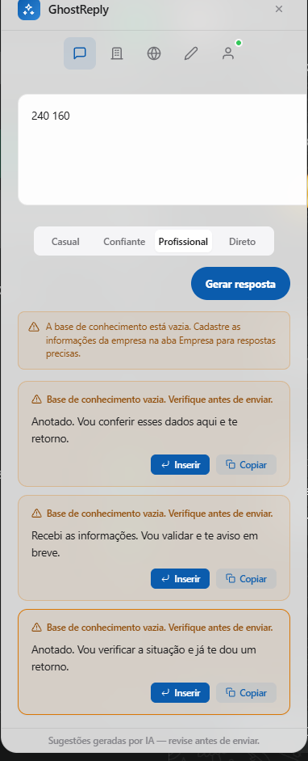

# GhostReply

Protótipo de extensão Chrome para criar sugestões de resposta no WhatsApp Web. A IA usa as informações de atendimento cadastradas e sinaliza quando uma resposta precisa de revisão. Confira as sugestões antes de enviá-las.

A captura mostra sugestões com a base de conhecimento vazia.

JavaScript · Chrome Manifest V3 · Node.js · Express · Supabase/PostgreSQL · JWT · bcrypt · OpenRouter

Fluxo: extensão → backend Express → banco de dados / provedor de IA.

## Português

### O que já funciona
- Cadastro, login, perfil da empresa e perguntas frequentes salvas no Supabase.
- Geração real de três sugestões, tradução e revisão pela API da OpenRouter.
- A extensão não contém a chave da IA ou do banco. Ela chama um backend local.

### Iniciar no Windows
1. Instale Node.js 18 ou posterior.
2. Crie seu projeto Supabase e execute `backend/src/database/setup.sql`. Copie `backend/.env.example` para `backend/.env` e preencha a chave secreta do Supabase, JWT e OpenRouter.
3. No PowerShell, execute `cd backend`, `npm ci` e `npm start`.
4. Em `chrome://extensions`, ative o modo de desenvolvedor e carregue esta pasta.
5. Faça cadastro, preencha seu perfil e adicione informações conhecidas da empresa.

A configuração das tabelas está em [backend/src/database/setup.sql](backend/src/database/setup.sql). Passos detalhados em [COMO-ATIVAR.md](COMO-ATIVAR.md).

O provedor gratuito tem limites e pode ficar indisponível. O backend bloqueia modelos pagos. As funções de IA enviam o texto necessário ao provedor externo; não envie dados sensíveis de clientes.

### Verificação feita
Cadastro/login, persistência, isolamento de dados entre duas contas temporárias, refresh/logout, 12 testes automatizados e chamadas reais de IA passaram em teste local. Contas temporárias foram removidas. O autor confirmou o funcionamento da extensão no WhatsApp Web em teste manual local. SMTP, login Google e hospedagem pública exigem configuração adicional. O projeto não foi publicado na Chrome Web Store. A IA pode errar; as sugestões exigem revisão humana. Mudanças no WhatsApp Web podem exigir ajustes nos seletores.

## English

GhostReply is a Chrome extension that suggests replies for WhatsApp Web using company information entered by the user. Suggestions need human review.

### Working features
- Sign-up, login, company profile and FAQ storage in Supabase.
- Three real AI reply suggestions, translation and writing review through OpenRouter.
- AI and database keys stay on the local backend; the extension calls that backend.

### Run on Windows
1. Install Node.js 18 or newer.
2. Create your Supabase project and run `backend/src/database/setup.sql`. Copy `backend/.env.example` to `backend/.env` and set the Supabase secret key, JWT secret and OpenRouter key.
3. In PowerShell run `cd backend`, `npm ci` and `npm start`.
4. Load this folder as an unpacked extension from `chrome://extensions` with Developer mode enabled.
5. Register, fill in the company profile and add verified company facts.

Table setup is in [backend/src/database/setup.sql](backend/src/database/setup.sql). See [COMO-ATIVAR.md](COMO-ATIVAR.md) for details.

The free model has usage limits and may be unavailable. Paid models are blocked. AI requests send the relevant text to the external provider; do not send sensitive customer information.

12 automated tests passed. Local integration checks covered authentication, data persistence and isolation, token refresh/revocation and real AI responses. Temporary test accounts were removed. The author confirmed the extension works in a local manual WhatsApp Web test. SMTP, Google sign-in and public hosting require additional setup. This is a local prototype with no Chrome Web Store release. AI output can be inaccurate and needs human review. WhatsApp Web changes may require selector updates.

## Site do projeto / Project website

[Apresentação, prints, instalação e download / Overview, screenshots, setup and download](https://fwestarb.github.io/ghostreply/).

Código do site: [website](website). Publicação e testes: [docs/SITE.md](docs/SITE.md).

Outros projetos / Other projects: [ESP32 Tera](https://fwestarb.github.io/esp32-tera/) · [GhostReply](https://fwestarb.github.io/ghostreply/) · [Projeto Câmera](https://fwestarb.github.io/projeto-camera/).
